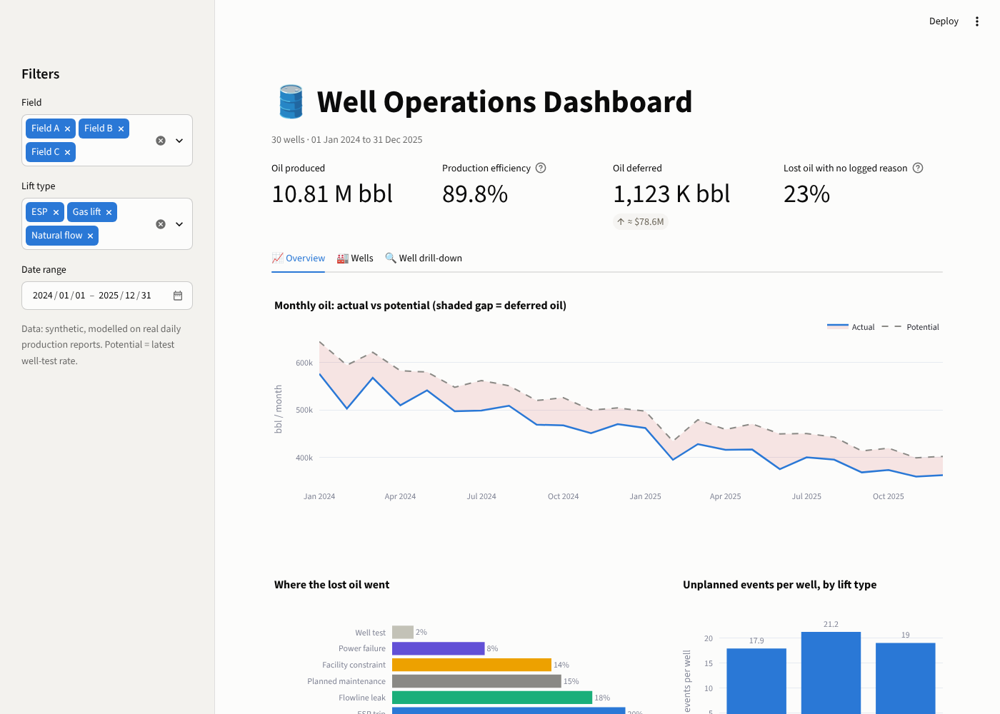
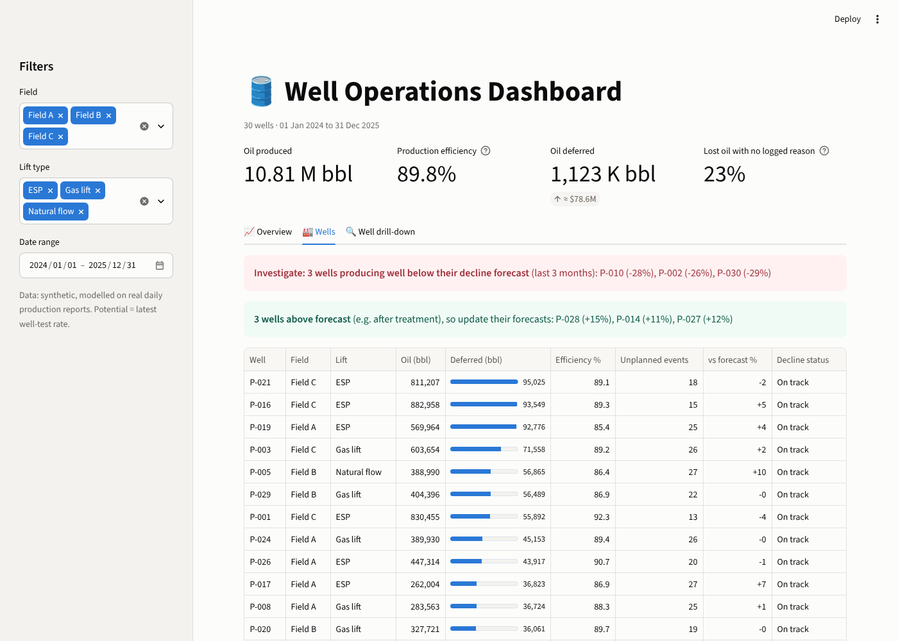
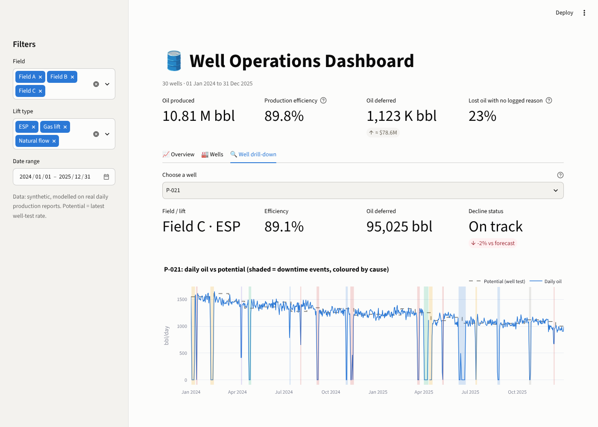

# 🛢️ Well Operations Dashboard (Streamlit)

An interactive dashboard that production engineers can open every morning to see **how much oil
is being lost, why, and which wells need attention**, then drill down into any single well.

**Live app:** _add your Streamlit Cloud link here after deploying (see below)_



## What a user can do
| Tab | Question it answers |
|---|---|
| **Overview** | How are we doing vs potential? Where did the lost oil go (by cause)? Which lift type has the most unplanned events? |
| **Wells** | Which wells lose the most oil? Which are drifting below their decline forecast (investigate) or above it (update forecast)? Download the table as CSV. |
| **Well drill-down** | For one well: daily oil vs potential, every downtime event shaded by cause, and the event list. |

Sidebar filters (field, lift type, date range) update every number and chart.

| Wells tab | Drill-down tab |
|---|---|
|  |  |

## Run locally
```bash
pip install -r requirements.txt
streamlit run app.py          # opens http://localhost:8501
```

## Deploy free on Streamlit Community Cloud (≈ 5 minutes)
1. Push this folder to a **public GitHub repo**.
2. Go to **share.streamlit.io** → sign in with GitHub → **Create app**.
3. Pick the repo, branch `main`, main file `app.py` → **Deploy**.
4. Copy the app URL into this README and onto your CV / LinkedIn.

## How it is built
* **Streamlit** for the app, **Plotly** for interactive charts (hover, zoom), **pandas** for filtering/aggregation.
* `@st.cache_data` caches loaded data so filters respond instantly.
* Data in `data/` is the cleaned output of my companion project
  [*Production Deferment & Well Performance Analytics*](../production-deferment-analytics):
  daily production with potential and deferment, downtime events (built in SQL with gaps-and-islands),
  and decline-curve status per well. The data is synthetic (no confidential data) and modelled on real
  daily production reports.

## Design choices
* KPI tiles first: the four numbers a manager asks for, with tooltips that define each metric.
* Problem wells are surfaced automatically (red = investigate, green = update forecast), so users don't have to hunt for them.
* One consistent colour per downtime cause across every chart; "not logged" is always red.
* Downloadable tables, because engineers will want to take the data into their own tools.
